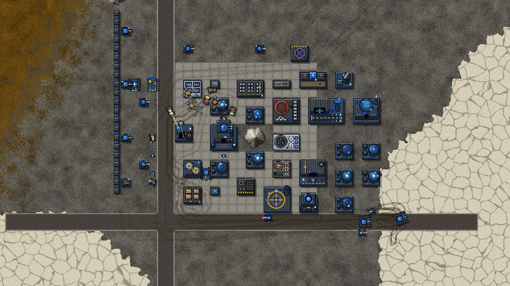
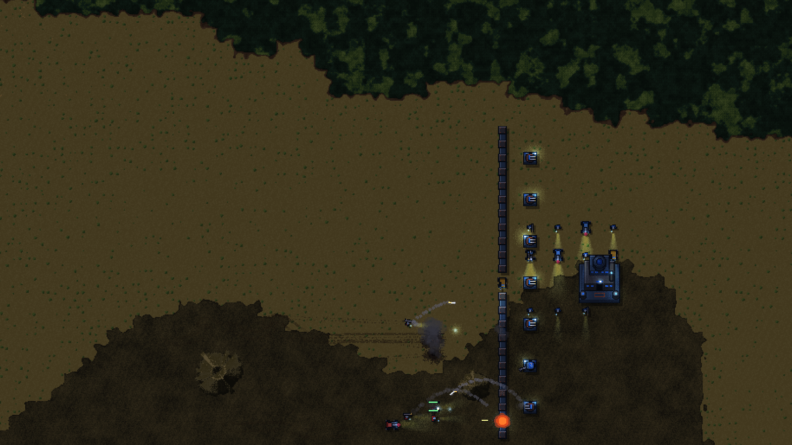
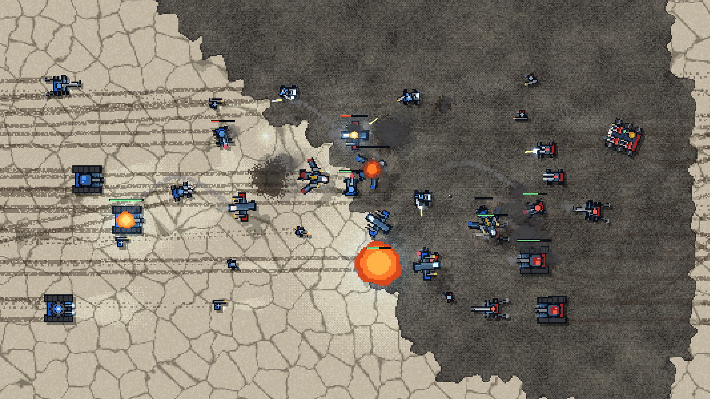
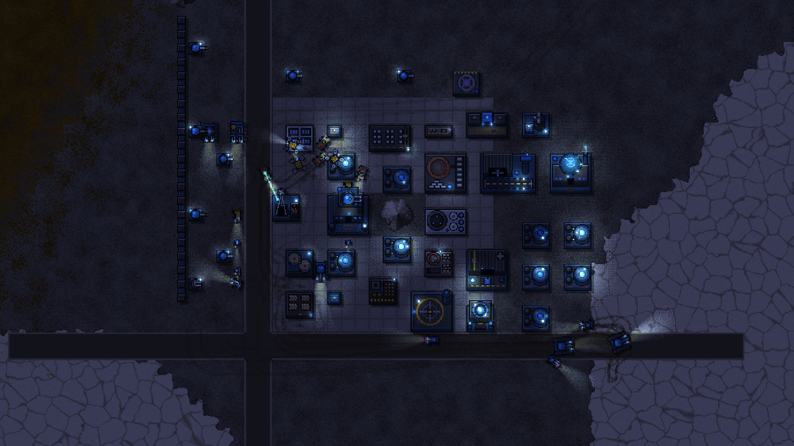
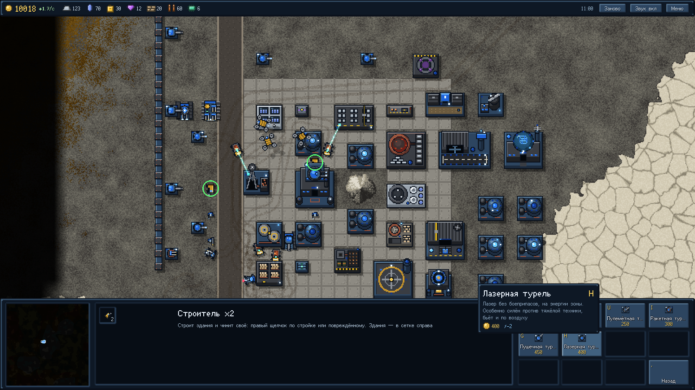

# Kharos

Многопользовательская браузерная RTS в духе Rusted Warfare и Rust. Игрок начинает не с готовой базы, а с машины-основателя (MCV) и небольшого отряда. Дальше он разворачивает поселение на процедурной карте, добывает и перерабатывает руду, налаживает грузовую логистику и защищает базу.

🎮 [Играть](https://vicimpa.github.io/kharos/) · 📺 [YouTube](https://www.youtube.com/@kharos_game) · 💬 [Discord](https://discord.gg/hellcord)



## Что уже есть

- **Процедурная карта.** Считается из сида, размером 512, 1024 или 2048 тайлов. Четыре биома: эрг, солончаки, красные пустоши и топи. Местность влияет на игру: строят только на скале, песок и болото замедляют технику, а горы непроходимы.
- **Пиксель-арт без ассетов.** Местность рисует один GLSL-шейдер, а здания и юниты собираются из чертежей в модах.
- **Погода и время суток.** Пыль, дождь, снег, ветер, ночь, а ещё огни зданий и фары.
- **Экономика.** Шахты дают руду, её перерабатывают в ресурсы, а из ресурсов собирают изделия. Грузовики сами развозят грузы по заявкам, а космопорт продаёт их за кредиты.
- **Бой.** Боевые юниты в четырёх классах, у каждого есть контр-юниты. Ещё есть стены и турели на боеприпасах, а также туман войны.
- **Дерево технологий.** Здания открываются по цепочке от главного: электростанция, шахта и переработка, радар, а за ним военное. Строители кладут фундамент, дороги и мосты.
- **Логистика и тактика.** Маршруты, фильтры и назначение грузовиков на здания, летающий грузовик, дропы с груза разрушенного — их можно вывезти по приказу. У бойцов есть стойки и патруль, у производящих зданий — точка сбора.
- **Звук и музыка.** Тоже синтезируются в коде: бой, работа зданий и техники, ветер и фон заброшенной земли, интерфейс, музыка в меню. Громкость настраивается по группам.
- **Уведомления.** Когда замечен противник или атакована база, звучит сигнал, в ленте появляется строка (щелчок переносит камеру к месту), а на мини-карте — кольцо.
- **Телефон и планшет.** На узком экране интерфейс перестраивается: панели в два ряда, кнопки под палец. Сенсорное управление — в работе.
- **Моды.** Механики, интерфейс, звук, камера и погода — моды на Luau (`mods/base`); движок на Rust не знает правил игры.
- **Языки.** Русский, английский, испанский, французский, немецкий, португальский, украинский и узбекский.
- **Сеть.** Игра по сети переносится на новый движок; пока — одиночная игра, редактор, тестовая карта и показательный бой.

| | |
| --- | --- |
|  |  |
|  |  |

<p align="center"></p>

## Запуск

Нужен Rust ([rustup](https://rustup.rs)): версию и цель wasm32 он возьмёт из `rust-toolchain.toml`.

```bash
cargo run --release --bin kharos   # игра в окне
cargo test --release               # тесты
```

В браузере клиент собирает [trunk](https://trunk-rs.github.io/trunk/):

```bash
cd apps/client/web
trunk serve --release              # http://127.0.0.1:8090
trunk build --release --public-url ./   # страница в target/web — её выкладывает GitHub Pages
```

Сервер для игры по сети — `cargo run --release -p kharos-server` (настройки — `settings.json` в рабочей папке, пишется
при первом запуске; [docs/net.md](docs/net.md)); окно подключается к нему с `KHAROS_SERVER=ws://адрес:8787`.

Переменные окружения окна: `KHAROS_GAME` — сразу в партию (`skirmish`, `sandbox`, `battle`), `KHAROS_MODS` — папки
модов, `KHAROS_CONFIG` — папка настроек и сохранений (по умолчанию `~/.config/kharos`), `KHAROS_SHOT` — снять кадр и
выйти (подробнее — в начале `apps/client/src/shell.rs`). В браузере партию задаёт `?game=`.

Сценарии без человека — `kharos --scenario файл.luau`: тесты интерфейса и механик (`tests/scenarios`, их гоняет
`cargo test`) и ролики со звуком любого размера (`--record файл.mp4 --sound --size 540x960 --scale 2`). Справочник —
[docs/scenarios.md](docs/scenarios.md).

### Устройство репозитория

- `apps/client` — клиент: окно (winit, glutin, glow) и браузер (wasm32, web-sys), рендер, свой интерфейс, звук,
  подача из модов;
- `crates/world` — мир столбцами по схеме из модов и хост: системы, команды, события, сигналы, обзор и память игроков;
- `crates/net` — сеть: что видит игрок, кадры, реплика у клиента; `apps/server` — сервер по WebSocket;
- `crates/content` — загрузка модов в машину Luau; `crates/engine` — земля, слои и счёт;
- `mods/base` — сама игра: механики, интерфейс, звук, облик, словари;
- `vendor/ulua-rt` — Luau на чистом Rust с нашими правками.

## Стек

Rust: winit, glutin и glow — окно и рисование, fontdue — шрифты, web-audio-api — звук, ulua — Luau. В браузере —
wasm32 и web-sys. Моды — на Luau.

## Документация

- [Подробное описание](docs/overview.md): что работает, управление, замысел игры.
- [Игровой процесс и баланс](docs/gameplay.md).
- [Лор](docs/lore.md): планета, харит, кто и зачем сюда прилетает.
- [Дизайн и план работ](docs/design.md).
- [Известные баги](docs/bugs.md).
- [Моды](docs/mods.md): разделы, виды, API подачи и правил.
- [Движок и контент](docs/content.md), [перенос на Rust](docs/port.md).

## Лицензия

Код распространяется по [Mozilla Public License 2.0](LICENSE). Изменения в файлах проекта, которые вы распространяете
или выкладываете вместе со своей сборкой, должны оставаться открытыми под той же лицензией; свой новый код в
отдельных файлах — моды, обвязку, порт на другую платформу — можно лицензировать как угодно, в том числе закрыто.
